# OLED Window Guard for KDE Plasma

**Keep your windows moving. Care for your OLED.**

OLED Window Guard automatically shifts and rearranges application windows and dims inactive content. Movement and brightness guarding have independent controls, display selections and settings. The application opens paused so you can review your desktop before starting either guard.

Created by **Dr. Brett Addison**. This is the KDE Plasma edition; the [macOS edition](https://github.com/baddison2005/oled-window-guard) is maintained separately.

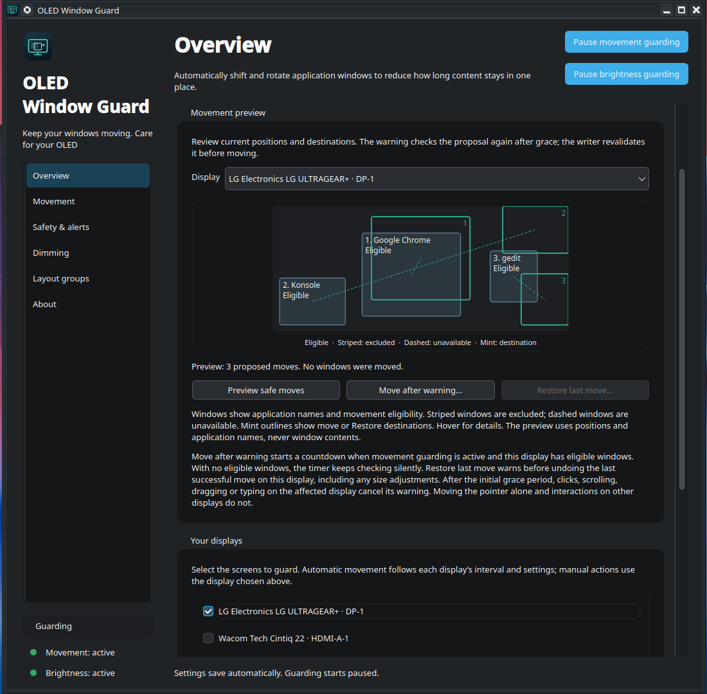

## Features

- **Shift position:** move windows within a configurable range, with optional horizontal and vertical order changes.
- **Swap positions:** rearrange windows and groups of similar neighbours, including tightly occupied layouts. Small, bounded size adjustments accommodate rounding at adjacent edges.
- **Layout groups:** move within zones or rotate among them. Use built-in layouts or import the read-only library from [Window Layouts for KDE](https://github.com/baddison2005/window-layouts-kde).
- **Movement preview:** view current window locations, application names, exclusions and proposed destinations for the selected display. Previewed destinations are used by Move after warning while the plan remains valid; the warning refreshes the proposal and checks again after its grace period.
- **Warnings and Restore:** a visible countdown, optional sound, Skip, and one-shot Restore of the last verified move, including size changes. Restore previews its destinations and refuses stale geometry.
- **Independent display timers:** select movement displays, set per-display overrides and see when the next check is due. Displays with no eligible windows are checked silently.
- **Window and monitor dimming:** independently set darkness, activation delay and fade duration. Dimming tracks window movement and continues during warnings, moves and restores.
- **Separate app exemptions:** exclude applications from movement, dimming or both. Docks and desktop surfaces are not treated as ordinary application windows.
- **Desktop-click behavior:** keep the clicked display bright or temporarily restore brightness and restart its dimming timers. Other displays retain their timers.
- **Restore brightness:** use the dashboard, tray or **Meta+Shift+B**. The shortcut can be disabled or customised through KDE.
- **Session continuity:** optionally resume previously active guarding after unlock or wake. Guarding on a remaining display continues when another monitor disconnects. Fresh app and system startup remain paused.
- **Desktop integration:** system tray, launch at login, start minimized, independent Start/Pause controls, and labeled movement/brightness status lights.

## In action

**Move and Restore:** three application windows move after the countdown, then return to their original positions after the Restore warning.

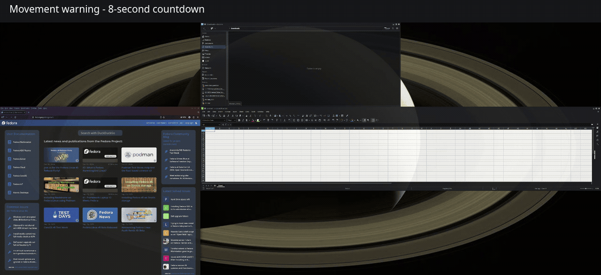

**Window and monitor dimming:** inactive windows dim, followed by the whole monitor. Restore Brightness clears both effects, with a longer hold on the fully restored desktop at the end. Idle waiting between dimming stages is trimmed; fades play at normal speed.

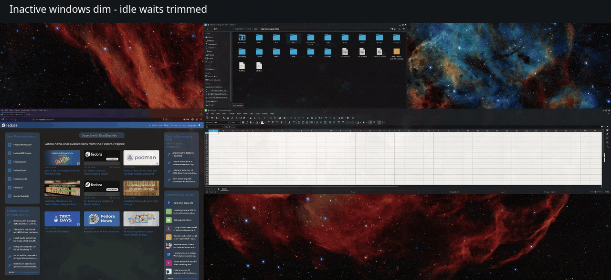

## Screenshots

<details>
<summary>Movement settings and warning countdown</summary>

Choose movement style, range, timing and the maximum number of windows. Configure selected displays individually when needed.

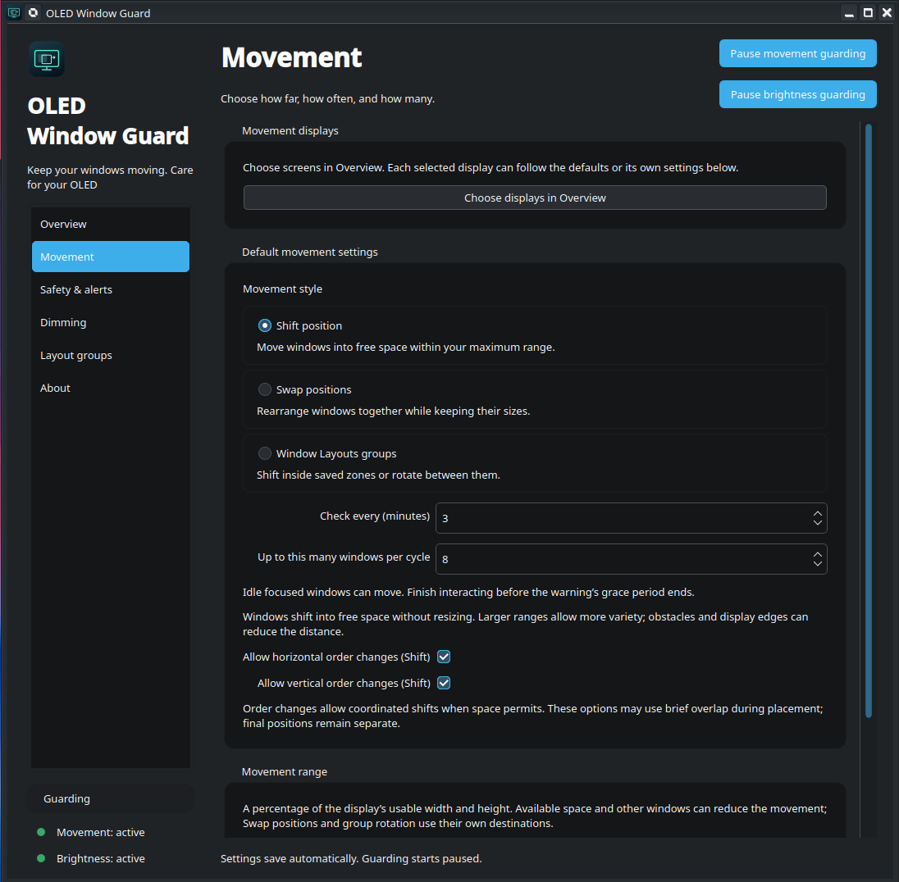

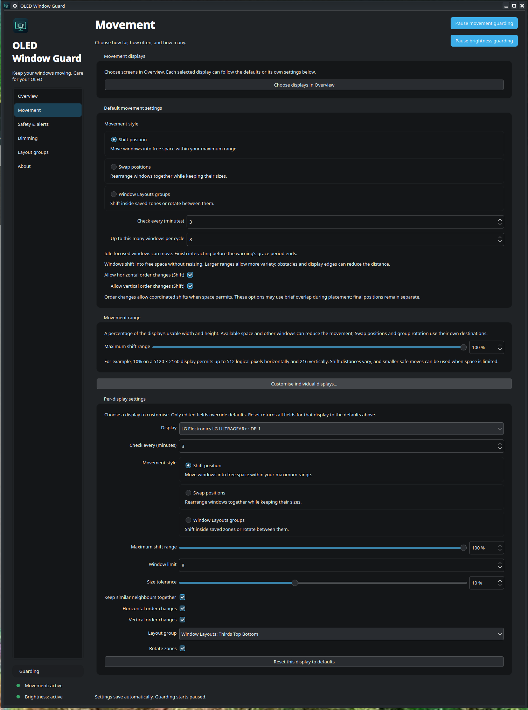

The warning shows the remaining time before movement and provides cancellation controls.

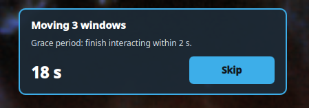

</details>

<details>
<summary>Safety and alerts</summary>

Configure interaction grace, exclusions, alerts and startup/session behavior.

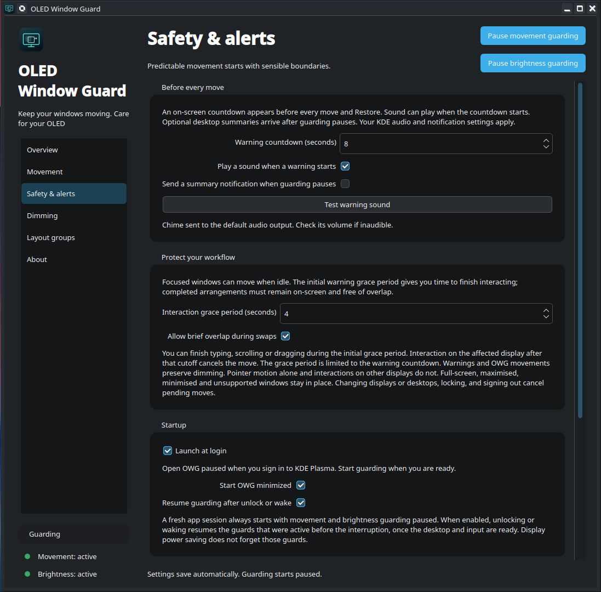

</details>

<details>
<summary>Window and monitor dimming</summary>

Set independent darkness, delays and fades for inactive windows and displays, with brightness exemptions and desktop-click behavior.

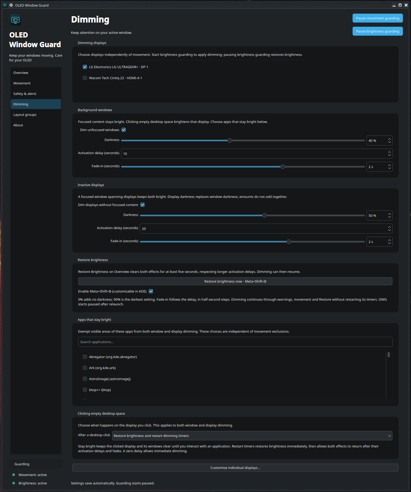

</details>

<details>
<summary>Layout groups</summary>

Use layout zones to constrain window movement or rotate windows among zones.

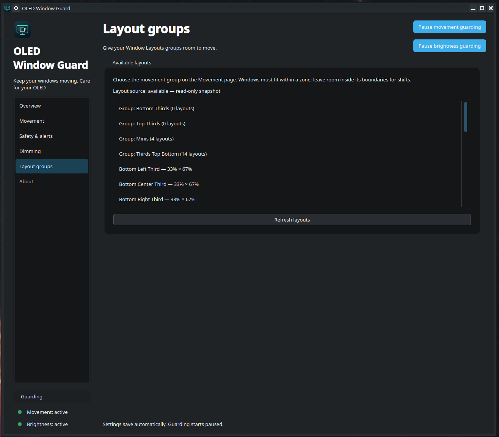

</details>

<details>
<summary>Tray and Cairo-Dock controls</summary>

Start or pause movement and brightness independently, request movement or Restore, and restore brightness from the desktop menus. Labels and availability follow the guard states.

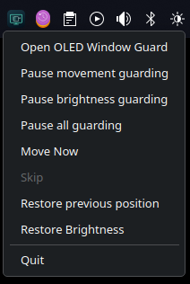
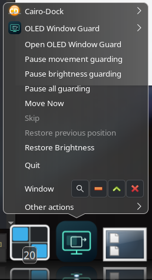

</details>

<details>
<summary>About and update checks</summary>

Check the installed package and GitHub for a newer compatible release.

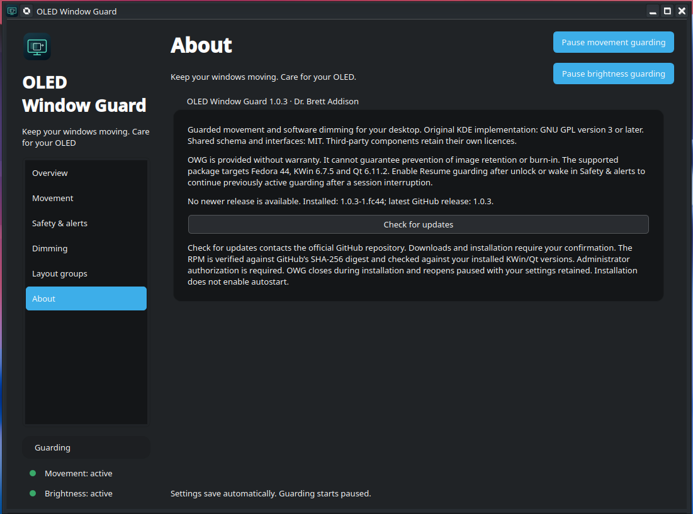

</details>

## Supported system

The v1.0.6 RPM targets **Fedora 44, x86_64, KDE Plasma Wayland, KWin 6.7.5 and Qt/PySide6 6.11.2**. Python 3.11 or newer is required.

The native observer uses version-specific KWin interfaces. The RPM deliberately requires the matching KWin and Qt versions; it is not a generic package for every Plasma release or distribution. A system update to different KWin/Qt versions requires a compatible OWG build. XWayland application windows are supported inside the tested Wayland session; an X11 desktop session is not supported.

## Install

1. Download `oled-window-guard-1.0.6-1.fc44.x86_64.rpm` and `SHA256SUMS` from [v1.0.6](https://github.com/baddison2005/oled-window-guard-kde/releases/tag/v1.0.6).
2. In the download directory, verify the RPM checksum against `SHA256SUMS`:

   ```sh
   sha256sum oled-window-guard-1.0.6-1.fc44.x86_64.rpm
   ```

3. Quit an existing OWG session, then install:

   ```sh
   oled-window-guard quit  # Only needed if OWG is already running.
   sudo dnf install ./oled-window-guard-1.0.6-1.fc44.x86_64.rpm
   ```

4. Open **OLED Window Guard** from the application launcher, or run `oled-window-guard open`.

The release RPM is unsigned; checksums accompany the downloads. Dependencies come from your configured Fedora repositories. In About, choose **Check for updates** to query the latest stable GitHub release, then **Download and upgrade** when a newer compatible RPM is offered. Manual downloads and installation with DNF remain available. Installation does not enable login startup or start guarding.

For an upgrade, quit OWG before installing the new RPM. If you previously installed a user-local development copy, remove it using its installer/ownership manifest before using the RPM so that it cannot shadow the packaged launcher or compositor script.

## In-app upgrades

**About → Check for updates** queries the official GitHub repository only when requested. A newer Fedora 44 x86_64 RPM shows **Download and upgrade**. A failed/offline check is reported as an error rather than as “up to date.” Checking alone does not download an RPM or install anything.

Confirm the upgrade to download it. OWG verifies GitHub's SHA-256 asset digest, the RPM name/version/architecture and its exact KWin/Qt requirements before closing. The session helper closes the existing controller and unloads its compositor runtime, then DNF requests administrator authorization. Settings and login preferences are backed up and retained. The app reopens paused, including after cancelled authorization or an installation failure. The reopened About page reports the result. Failed download or preflight checks leave the running app in place.

Upgrades cannot silently change the compositor/Qt version. The installer uses installed dependencies without enabling remote repositories; if a future release needs additional dependencies, use manual DNF installation with the configured Fedora repositories. RPMs are currently unsigned; verified downloads use the official HTTPS GitHub release and its SHA-256 digest. There is no unattended upgrade, forced downgrade or new autostart opt-in.

## First use

1. In **Overview**, select the movement displays and the display to preview.
2. In **Movement**, choose a movement style, interval and window limit. Per-display overrides are optional.
3. Select **Preview safe moves** to inspect the proposal. Start movement guarding and choose **Move after warning** for an immediate cycle, or wait for the scheduled check.
4. In **Dimming**, select displays and enable the desired effects. Start brightness guarding separately.
5. In **Safety & alerts**, configure warning length, interaction grace, app movement exclusions, launch at login, minimized startup and resume after unlock or wake.

The bottom-left lights show each guard separately: **green = active**, **grey = paused**, **amber = waiting or unavailable**. Text labels also identify the state. Closing the dashboard leaves the tray/controller running; **Quit** stops both guards and removes dimming.

## Cairo-Dock and launcher menu

While OWG is running, right-click its application icon in Cairo-Dock for the same live controls as the tray: **Open OLED Window Guard**, **Start/Pause movement guarding**, **Start/Pause brightness guarding**, **Start selected/Pause all guarding**, monitor-specific **Move now**, **Skip**, **Restore previous position**, monitor-specific **Dim now** and **Restore brightness**, all-display brightness actions, and **Quit**.

Movement and brightness labels follow their independent guard states. Move Now, Skip and Restore previous position are disabled while movement is paused; Restore Brightness is disabled while brightness is paused. Availability also follows the controller's safety checks: Skip requires an active warning and Restore requires a verified last move. **Restore previous position — [monitor]** always targets the most recently moved monitor, independently of Overview selection, and switches the preview to that monitor. OWG retains one last-move record across all monitors. The menu updates from the same actions as the dashboard/tray.

**Move now**, **Dim now** and **Restore brightness** entries name each connected monitor selected for the relevant guard, including its connector where available. Menu targets are independent of Overview’s selected display. Restore entries enable only while that monitor has visible OWG dimming; restoring one monitor leaves the others unchanged. **Restore brightness on all displays** clears every OWG dimming effect.

**Dim all guarded displays now** applies to every connected display with active brightness guarding and monitor dimming enabled. The individual and all-display dimming actions skip the activation delay, use each display’s configured darkness and fade, and preserve app exemptions. They can dim a display with focused content. Application or empty-desktop interaction on that display, Restore Brightness, pausing, locking or runtime loss clears the manual effect. Opening a panel or dock menu preserves dimming and application inactivity clocks. Brightness guarding must be active.

The `move-now` CLI command uses the display selected in Overview when it is still selected for movement and connected, otherwise the first connected movement display. All existing warnings, capability checks and stale-plan refusals apply.

This integration requires Cairo-Dock's **D-Bus plug-in** with **SetMenu/libdbusmenu** support and the Plasma status notifier host. It is optional: the tray and dashboard work without it. OWG reconnects after a dock restart or launcher reload. When OWG is closed, clicking its icon opens it normally; a live guarding menu requires the app to be running. Fixed desktop-entry actions were removed to avoid duplicate controls. Other launchers continue to open OWG normally.

Cairo-Dock may cache the old fixed action list after an upgrade. If duplicate or fixed labels remain, quit and reopen Cairo-Dock once. Existing pinned launchers referring to `/usr/share/applications/oled-window-guard.desktop` use the updated package entry; replace a standalone copied/custom launcher with the installed application launcher if needed.

## Interaction and safety behavior

Focused but idle windows may move. During a warning's initial grace period you can finish an interaction. After that cutoff, typing, scrolling, clicking or dragging on the affected display cancels its move. Moving the pointer alone or interacting on an unrelated display does not cancel the warning. Held input and unknown input state still block writes.

If startup readiness asks for input state, click and release on each desktop, then release all held keys and buttons. Readiness details appear in Overview.

Every move is validated against current geometry, exclusions, output identity and native session/input observations. The writer checks each step and reads back the result. A partial or uncertain result pauses movement; it is reported rather than presented as a successful move. Restore is available only while its original window identities and expected geometry remain valid. Manual movement, resizing, closing windows or topology changes can invalidate it.

Full-screen, maximized, minimized, modal, unsupported and spanning windows may be ineligible. Existing substantial overlaps and limited free space can prevent a safe plan. Bounded planning can legitimately return no plan; a warning is shown only when a proposal is available. Adjacent rounding allowances do not permit new substantive final overlaps.

Dimming uses compositor overlays, not hardware brightness controls. Window and display darkness do not add together. Exempt app areas remain bright; a whole-display effect covers the movement warning. **Restore brightness** grants at least five seconds of brightness, respecting longer configured delays. Manual pauses remain paused across unlock/wake; resumption requires the corresponding option and previously active guarding. A disconnected target leaves its guard scope; reconnecting it does not automatically arm new work.

Movement and dimming cannot guarantee prevention of image retention or OLED burn-in. Keep your display's built-in care and sleep features enabled.

Saving Window Layouts layouts, groups or application mappings can reconfigure KWin. OWG’s companion-owned runtime remains loaded through those ordinary saves; guard state and timers continue. Actual runtime removal or lost heartbeats cancel pending work and recover paused, with stale Restore authority discarded.

## Settings, privacy and troubleshooting

Preferences are stored in `~/.config/oled-window-guard/settings.json` (or under `$XDG_CONFIG_HOME`). Changes save automatically. Runtime window identities, pending moves and Restore authority are memory-only. Uninstalling the RPM preserves your preferences.

OWG uses window geometry, application identity, focus and input activity timing. It does not capture window contents or record typed text. Preview draws rectangles and app names. Imported Window Layouts files are read-only. Routine diagnostic snapshot logging is disabled.

- **Unavailable after an update:** check About and verify the supported KWin/Qt versions. Reopen OWG after installing a compatible build.
- **No eligible windows:** check the selected display, app exemptions, geometry and movement mode. Preview shows eligibility; resizing or rearranging the layout can make a move possible.
- **Restore refused:** the desktop no longer matches the verified move. OWG does not force windows back over subsequent user changes.
- **Shortcut conflict:** resolve Meta+Shift+B in KDE's shortcut settings or disable OWG's shortcut and use Restore brightness in the dashboard.
- **Remove the app:** quit OWG, disable Launch at login if enabled, then run `sudo dnf remove oled-window-guard`.

Report reproducible issues through [GitHub Issues](https://github.com/baddison2005/oled-window-guard-kde/issues), including OWG, Fedora, KWin and Qt versions, display scaling, movement style and the exact status message. Review diagnostics for personal information before attaching them.

## Build and test

See [SOURCE.md](SOURCE.md) and the [RPM build instructions](packaging/rpm/README.md). The release includes a complete source archive and source RPM corresponding to the binary package. Native builds require development headers matching the supported runtime versions.

From the source root, run the non-desktop suites:

```sh
for test in tests/core/*.test.js tests/safety/*.test.js; do node "$test" || exit; done
QT_QPA_PLATFORM=offscreen python3 -m unittest discover -s tests/ui
python3 -m unittest discover -s tests/settings
python3 -m unittest discover -s tests/integration -p 'test_*.py'
python3 -m unittest discover -s tests/packaging
```

`tests/integration/run_*.py` contains separate private-compositor and physical acceptance runners. They are not part of the unit-test commands above; read their prerequisites before running them. Some historical DNF/signing rehearsal runners require private development artifacts that are not included in this repository.

See the [v1.0.6 review](docs/RELEASE_REVIEW_v1.0.6.md) and [changelog](CHANGELOG.md) for release scope and validation.

## License

Copyright © 2026 **Dr. Brett Addison**.

The original KDE controller, dashboard, compositor, native observer, tools and artwork are licensed under **GNU GPL version 3 or later**. Shared settings schema and interface definitions are **MIT** licensed. See [LICENSE](LICENSE), [NOTICE](NOTICE) and [third-party notices](packaging/licenses/THIRD_PARTY_NOTICES.md). The macOS edition has its own licensing terms.
